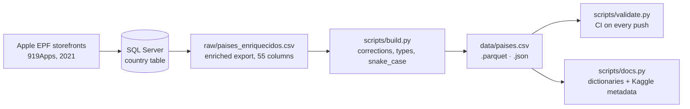

# Methodology

## 1. Origin (2021–2022): the 919Apps country list

The list of countries comes from **919Apps**, a programmatic catalog of 2.4 million apps generated from the Apple Enterprise Partner Feed (EPF) and published in 176 country storefronts ([archived site](https://web.archive.org/web/20211203115104/https://919apps.com/lca/download-app-mhs-schedule)). Each storefront needed a country record to build localised pages with .NET `CultureInfo` and `RegionInfo`.

The original table had eight columns:

| Original column | Used for |
|---|---|
| `pais` | English short name, as in the App Store storefront list |
| `macroContinente`, `continente` | Grouping countries on the home page |
| `inicial` | Pages by initial (identical to `continente` in the export; dropped) |
| `language`, `languages` | Main language and ISO 639-2 language list |
| `country_code_3`, `country_code_ISO_3166-1_alpha-2` | ISO codes |

This explains the coverage: the dataset has the **167 countries and territories that had an App Store storefront** in the export, not every country in the world. Cuba, Iran, North Korea and Syria, for example, are absent.

## 2. Enrichment (2026)

The table was extended to 55 columns, each following a reference standard:

| Group | Standard |
|---|---|
| Codes | ISO 3166-1 (alpha-2, alpha-3, numeric), IOC |
| Regions | UN M49 regions and sub-regions |
| Currencies | ISO 4217, symbols from Unicode CLDR |
| Languages | ISO 639-1 / 639-2, BCP 47 locales |
| Locale formats | Unicode CLDR: first day of week, 12/24h, short date pattern, separators, measurement system, paper size |
| Time | IANA time zone database |
| Telephony and web | ITU-T E.164 calling codes, IANA root zone ccTLDs |
| Geography and population | Approximate values, circa 2024–2025 |

## 3. Review and correction

Every column was profiled and cross-checked:

- ISO alpha-2, alpha-3 and numeric codes were checked against ISO 3166-1: all 167 match.
- Borders were checked for symmetry (if A borders B, B borders A) and against `border_count`.
- Density was recomputed from population and area.
- Writing direction was checked against the RTL language flag, and the locale region against the ISO code.

The errors found and how each one was treated are listed in [data-quality.md](data-quality.md).

## 4. Pipeline



`raw/` is never edited by hand. Every change from raw to clean is code in `scripts/build.py`, so the whole dataset can be rebuilt and audited:

```bash
pip install -r requirements.txt
python scripts/build.py && python scripts/validate.py && python scripts/docs.py
```
